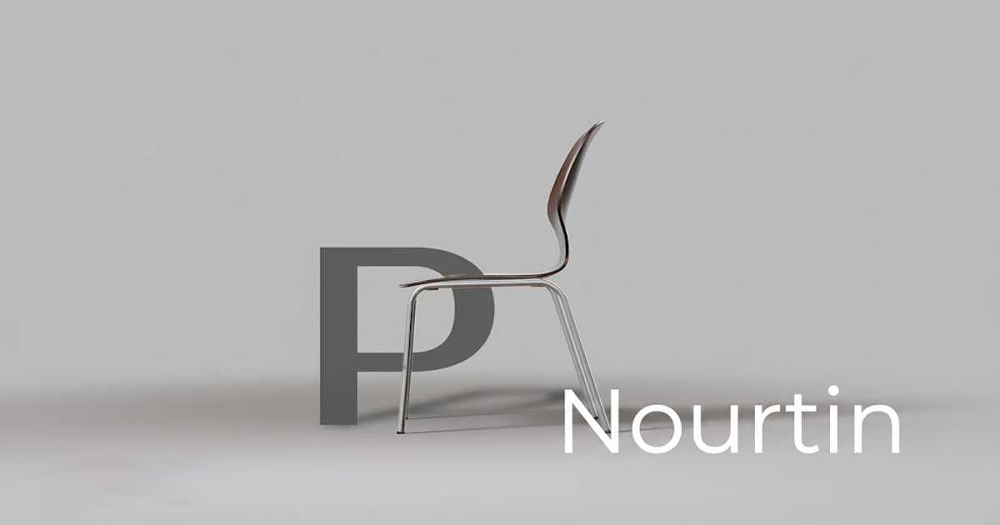
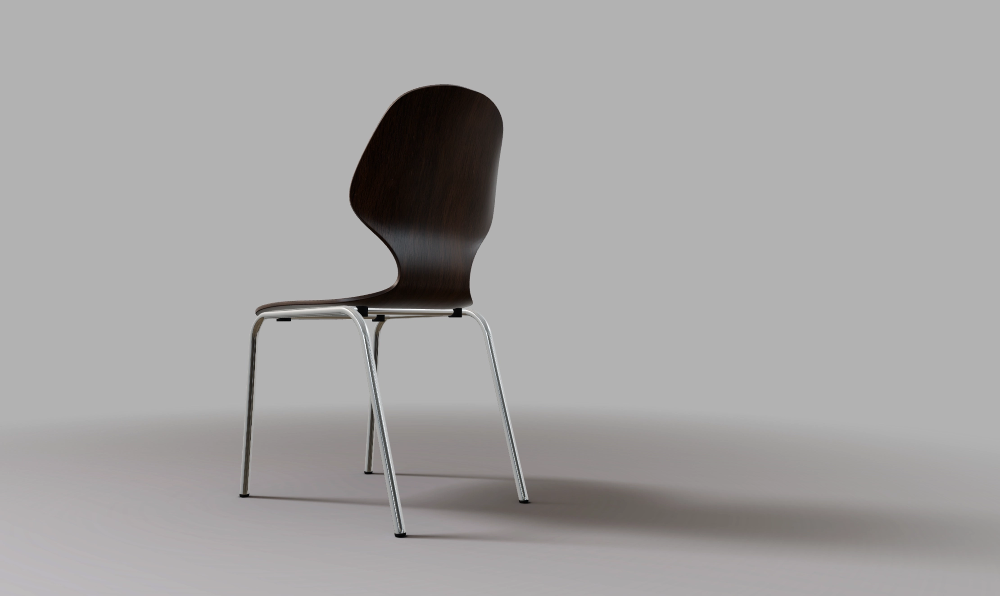
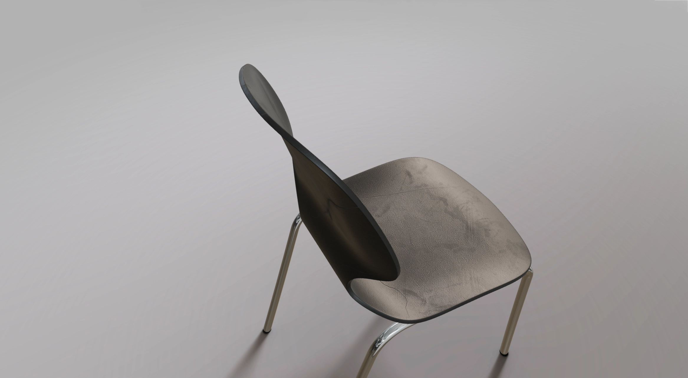
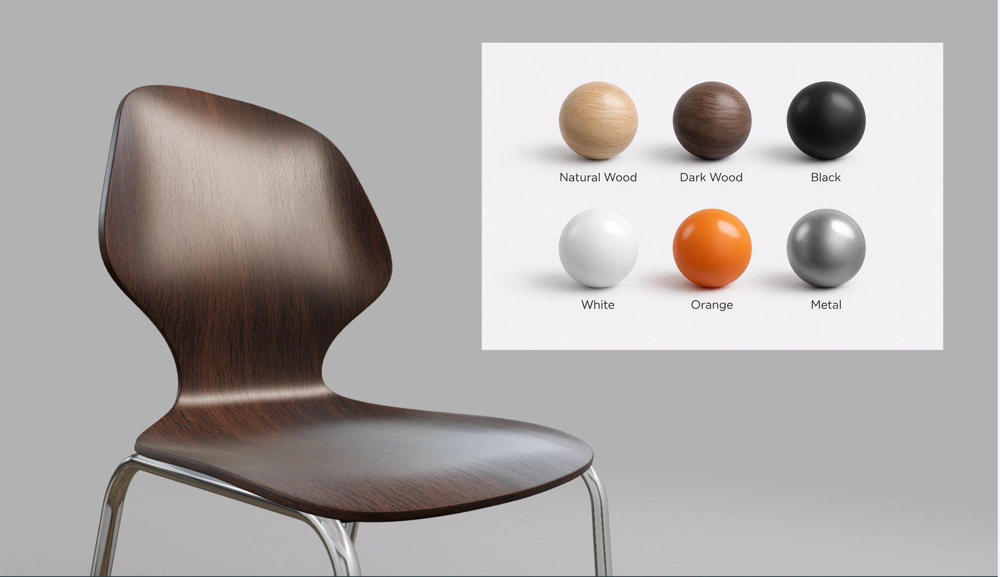
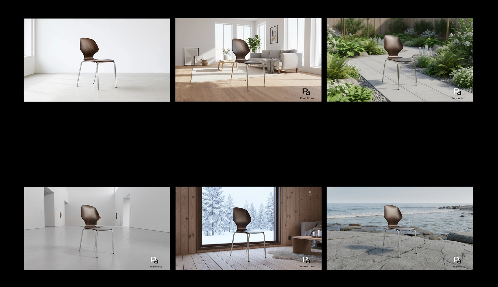
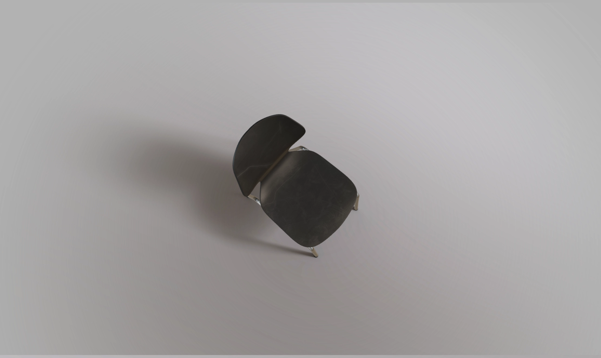
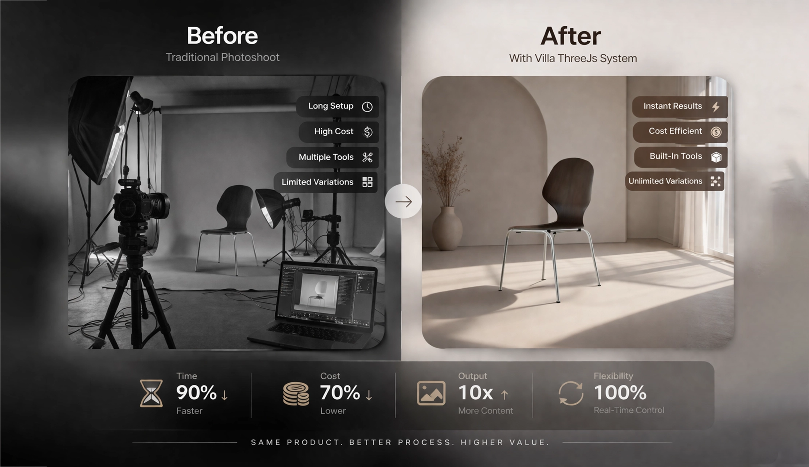

# PureNordStudio — Cinematic 3D Product Experience

🔗 Live Demo: https://purenordstudio.nourtin.com/  
📖 Full Case Study: https://nourtin.com/pages/Subpages/purenordstudio-realtime-viewer.html  

Cinematic real-time 3D product experience built for modern brands — combining interactive product exploration, studio tools, and AI-powered visual generation inside one browser-based system.

---

## Key Results

- Cinematic product presentation directly in the browser  
- Real-time material exploration, including a White Clay inspection mode  
- On-model width, height, and depth dimensions with interactive product details  
- Approximately 0.5–0.7 seconds to initial opening in the author's recent measurements; results vary by device and connection  
- Built-in studio workflow (image & video capture)  
- AI-powered image generation from live 3D scene  
- Designed for modern product storytelling and digital marketing  

---

## Product Experience

A premium product experience that presents objects with cinematic quality instead of static images or basic viewers.

---

## Interactive Features

Users can explore materials in real time, capture visuals, and create content directly inside the browser without switching tools.

The new White Clay mode presents the entire chair with a neutral finish, making its form easier to inspect. Width, height, and depth appear directly around the model, alongside interactive points that open design views, seat and frame connection details, and an assembly overview.

Dimensions and detail points remain visible while White Clay is selected, even when the material panel is closed. Switching to another finish returns to the material presentation.

Users can also enter and leave a staged room environment to explore the chair in context.

---

## AI Workflow

The system allows users to generate new AI-based product visuals directly from the live 3D scene.

This turns a single product setup into multiple creative outputs without leaving the experience.

Recent improvements make generation more predictable, with clearer access feedback and better handling of cancelled, delayed, or failed requests.

---

## Project Overview

PureNordStudio was built to move beyond traditional product presentation.

Instead of showing products as static images or simple 3D viewers, the system creates a complete interactive experience where users can explore, customize, and generate new visuals in real time.

The goal is to bring product presentation, interaction, and content creation into one unified workflow.

---

## Core Experience

- Cinematic product introduction and camera flow  
- Real-time material switching without reloading the chair  
- White Clay inspection with on-model dimensions and interactive detail images  
- Room entry and exit with smooth visual transitions  
- Built-in studio tools for screenshots, camera previews, and video recording  
- AI-powered visual generation  
- Improved mobile and landscape layouts, keyboard navigation, and panel focus  
- Updated Nourtin branding across preview artwork and exported content  

---

## Latest Improvements

- **Faster initial opening:** approximately 0.5–0.7 seconds in recent measurements by the author, with additional scene content loading progressively.
- **Clearer product inspection:** White Clay mode, visible model dimensions, and interactive design and assembly details.
- **Smoother navigation:** refined camera handling, room transitions, and controls during studio preview and recording.
- **More reliable capture:** improved recording cleanup and resizing behavior, with consistent Nourtin branding on images and video.
- **Better recovery:** clearer Retry and Reload actions when loading or browser graphics initialization fails.
- **More accessible interaction:** improved keyboard access, focus handling, and controls on narrow and landscape screens.
- **More reliable AI workflow:** improved cancellation, timeout handling, and feedback.
- **Maintenance and quality:** removed unused code and obsolete assets, expanded project documentation, and added automated checks before deployment.

These updates describe the latest project work; availability in the live demo depends on deployment.

---

## Why It Matters

Modern product presentation is no longer just about showing an object.

It is about how clearly a product communicates its quality and how easily users can explore it.

PureNordStudio demonstrates how real-time 3D can enhance product storytelling, improve engagement, and support marketing workflows directly in the browser.

---

## Potential Business Value

- Faster content production without external tools  
- Reduced need for repeated photoshoots  
- More control for marketing and creative teams  
- Consistent product visuals across campaigns  

---

## Outcome

A portfolio browser-based system that combines real-time 3D, interactive exploration, and AI-powered content creation into one seamless experience.

This approach transforms product presentation from a static display into an interactive and scalable digital tool.

---

## Scope and measurement notes

This repository contains documentation and screenshots, not the complete application source or licensed assets. The approximately 0.5–0.7 second opening time is an author-reported observation under particular test conditions, not a cross-device benchmark or a guarantee. Initial opening and full scene loading are different milestones; results vary with device, connection, cache state, and scene mode. Displayed dimensions describe the 3D model and are not verified manufacturer specifications. The business benefits above describe intended use, not measured commercial outcomes.

[Author: Nour Altinawi — Nourtin](https://nourtin.com/)
